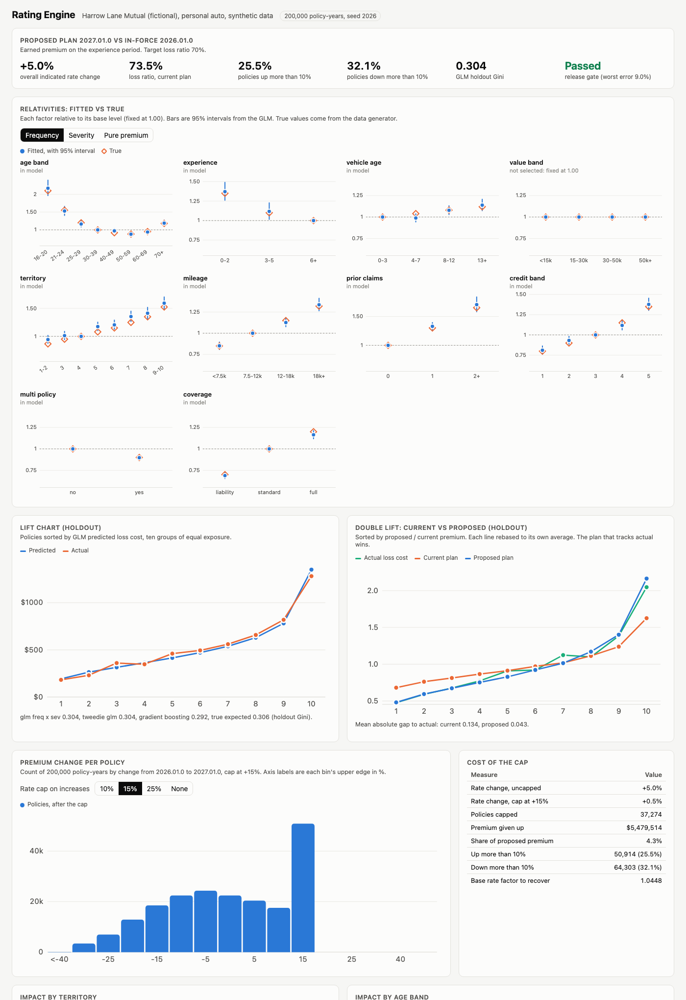

# Rating Engine

Personal auto pricing for Harrow Lane Mutual, a made-up insurer. It fits frequency and severity GLMs the way a pricing actuary does (Poisson with a log exposure offset, gamma weighted by claim count, Tweedie as an alternative), turns the coefficients into a versioned rating plan (base rate times one relativity table per factor), and measures the impact of the rate change on every policy before filing. The data is a seeded synthetic book of 200,000 policy-years generated from known true relativities, so every fitted number can be checked against the truth. A FastAPI service rates a policy with a full premium breakdown, and a web page shows the relativities, lift charts, and impact.

**Educational demo on synthetic data. This is not actuarial advice, and the plan is not fit for filing.**



## Results (200,000 policy-years, seed 2026)

16,922 claims and $89.5M of incurred loss on 166,877 car-years. Models are fit on a 70% split (140,280 policies) and checked on the other 30%.

**Fitted vs true frequency relativities** (Poisson GLM, 95% intervals, base level of each factor fixed at 1.00). Output of `make review`:

| Factor | Level | Fitted | 95% CI | True | Error |
|---|---|---:|---|---:|---:|
| age_band | 16-20 | 2.169 | 1.964 to 2.397 | 2.100 | +3.3% |
| age_band | 21-24 | 1.528 | 1.406 to 1.662 | 1.550 | -1.4% |
| age_band | 25-29 | 1.163 | 1.082 to 1.250 | 1.200 | -3.1% |
| age_band | 40-49 | 0.971 | 0.912 to 1.033 | 0.920 | +5.5% |
| age_band | 70+ | 1.188 | 1.107 to 1.276 | 1.180 | +0.7% |
| experience | 0-2 years | 1.371 | 1.261 to 1.491 | 1.350 | +1.6% |
| territory | 1-2 (merged) | 0.943 | 0.874 to 1.018 | 0.866 | +9.0% |
| territory | 7 | 1.353 | 1.264 to 1.450 | 1.250 | +8.3% |
| territory | 9-10 (merged) | 1.594 | 1.490 to 1.705 | 1.524 | +4.6% |
| mileage | 18k+ | 1.337 | 1.265 to 1.412 | 1.320 | +1.3% |
| prior_claims | 2+ | 1.703 | 1.580 to 1.836 | 1.650 | +3.2% |
| credit_band | 5 | 1.376 | 1.303 to 1.454 | 1.350 | +2.0% |
| multi_policy | yes | 0.897 | 0.865 to 0.931 | 0.900 | -0.3% |
| coverage | full | 1.165 | 1.119 to 1.212 | 1.200 | -2.9% |

The full table has 31 levels (`make review` prints all of them); 27 of 31 intervals contain the true value (about 29 would be expected at 95%). Every territory error has the same sign because each zone is measured against zone 4, and zone 4's own estimate came out about 5% low in this sample. Relative to each other the zones line up with the truth. The severity GLM finds the five factors that really drive cost per claim (vehicle age, vehicle value, territory, coverage, age band) and AIC drops the six that do not.

**Rate change impact, plan 2026.01.0 (in force) to 2027.01.0 (proposed):**

| Measure | Value |
|---|---|
| Loss ratio under the current plan | 73.5% (target 70%) |
| Overall indicated rate change | +5.0% |
| Policies up more than 10% | 50,914 (25.5%) |
| Policies down more than 10% | 64,303 (32.1%) |
| Median change, 5th to 95th percentile | -2.5%, -25.2% to +34.0% |
| Policies capped at +15% | 37,274 |
| Premium given up by the +15% cap | $5.48M, 4.3% of proposed premium |
| Overall rate change after the +15% cap | +0.5% |
| Same with a +25% cap | 19,197 capped, $2.92M given up, +2.6% overall |
| Largest segment moves | drivers 16-20 +33.7%, credit band 5 +20.5%, zone 9 +20.7% |

**Model quality on the holdout:**

| Model | Gini | Top / bottom decile loss cost |
|---|---:|---:|
| GLM frequency x severity | 0.304 | 7.05x |
| Tweedie GLM (p = 1.6) | 0.304 | 6.78x |
| Gradient boosting (benchmark only) | 0.292 | 5.95x |
| True expected loss cost (ceiling) | 0.306 | 7.15x |
| Current plan 2026.01.0 / proposed plan 2027.01.0 | 0.302 / 0.304 | |

Double lift (current vs proposed, sorted by their ratio): the mean gap between each plan's rebased premium and the rebased actual loss cost is 0.134 for the current plan and 0.043 for the proposed one. Under the current plan the loss ratio runs from 61% in zone 1 to 93% in zone 10 and from 65% to 102% across age bands; under the proposed plan it stays between 63% and 80% by zone and 67% and 76% by age.

What these numbers say: the GLM recovers the true relativities closely, its lift nearly matches the true expected loss cost, and gradient boosting adds nothing here (the data is multiplicative by construction, which is exactly the GLM's form; on real data it often finds interactions worth investigating). The plan is a clear improvement, but it moves a quarter of the book up more than 10%. A +15% cap gives back 4.3 points of the 5.0% indication, so the honest choices are a wider cap, a two-step filing, or a higher base rate to recover the cap cost (factor 1.045).

## Why

A pricing team has two jobs that pull against each other. It has to charge each risk what it costs, which means GLMs, many factors, and relativities that change every refresh. And it has to file and defend the result: a regulator and an underwriting team want to see exactly how a premium is built, which plan version produced it, how many customers move and by how much, and what the rate cap costs. Spreadsheets handle the second job badly and the first one not at all. This project shows the pipeline that does both: models fit with exposure offsets and checked on a holdout, a plain JSON rating plan with a hash, a premium breakdown that multiplies to the cent, and impact analysis that runs before anything is filed.

## How it works

```
 synthetic book (seeded)                         true relativities (factors.py)
 200k policy-years, exposure, 11 factors ──────────────────┐
        │ 70 / 30 split                                    │ compare
        ▼                                                  ▼
 1 fine bands, all candidates ─▶ 2 band ages, merge sparse zones ─▶ 3 backward AIC selection
        │                                                           │
        ▼                                                           ▼
 Poisson GLM (claims, offset log exposure)      gamma GLM (cost per claim, weight claims)
        └──────────────── relativity = freq x sev ────────────────┘   Tweedie GLM, GBM: lift benchmarks
                                    │
                credibility (Z = sqrt(claims / 1082), complement = current plan)
                cap to [0.45, 2.25]  ▸  off-balance base rate to a 70% loss ratio
                                    ▼
             rating plan 2027.01.0 (JSON, sha256)       plans/plan-2026.01.0.json (in force)
                                    │                              │
             lift, double lift, Gini, A/E 1-way and 2-way, loss ratio by segment
             premium change per policy, rate capping cost, impact by territory / age / credit
                                    ▼
                FastAPI: /rate  /api/plans  /api/results  /api/impact  /healthz  /metrics  /
```

- **GLMs** are fit with IRLS written in numpy (`src/ratingengine/glm.py`): log link, working weight `w * mu^(2-p)`, step halving, Pearson dispersion, and covariance for the intervals. Tests check it against closed-form answers (a one-factor Poisson GLM reproduces claims over exposure by level, gamma and Tweedie reproduce weighted means), against direct likelihood maximisation with scipy, and against scipy's Poisson and gamma log densities for AIC.
- **Banding and selection.** Ages start as single years up to 24 and five-year bands after that, then collapse to eight bands. Zones with less than 2.5% of exposure merge into the neighbor with the closest claim frequency (zones 1 and 10 here). Backward elimination by AIC removes `vehicle_color` (no true effect) and `value_band` from frequency, and six frequency-only factors from severity. Each step's holdout deviance is in the model comparison table on the page.
- **From coefficients to a plan.** Pure premium relativity is the product of the frequency and severity relativities. Levels with fewer than 1,082 claims are credibility-weighted toward the current plan's relativity for the same policies. Relativities are capped at 0.45 and 2.25 (the 16-20 band is indicated at 2.58 and capped). The base rate is set so the plan collects the target premium on the experience period (off-balance factor 1.023). The multi-policy factor becomes a 10.3% discount. `vehicle_color` would not be used even if it were selected.
- **The breakdown** from `/rate` lists the base rate and each multiplier with the running premium, so the arithmetic is auditable. Every response names the plan version and its sha256. A plan file whose content does not match its recorded hash is rejected at load.

## How to run

```bash
cd rating-engine
uv sync --python 3.12
make run                       # http://127.0.0.1:8870, fits 200,000 policies at startup (about 30 seconds)
make review                    # markdown pricing review (the tables above)
make gate                      # the CI release gate, exits 1 on failure
make plan                      # writes plans/proposed/plan-2027.01.0.json
RE_N_POLICIES=20000 make run   # smaller book, starts in a few seconds
```

Rate a policy:

```bash
curl -s localhost:8870/rate -H 'content-type: application/json' -d '{"policy": {"driver_age": 22,
  "years_licensed": 4, "vehicle_age": 2, "vehicle_value": 31000, "territory": 9, "annual_mileage": 16000,
  "prior_claims": 1, "credit_band": 4, "multi_policy": false, "coverage": "full"}}'
```

That returns $3,990.39 under 2027.01.0: base rate $544.80 x 1.639 (age 21-24) x 1.096 (3-5 years licensed) x 1.000 x 1.166 (value 30-50k) x 1.698 (zones 9-10) x 1.126 (12-18k miles) x 1.328 (one prior claim) x 1.117 (credit band 4) x 1.233 (full coverage), against $2,545.89 under the plan in force. Add `"plan_version": "2026.01.0"` to rate under the older plan.

Other endpoints: `GET /api/plans`, `GET /api/plans/{version}`, `GET /api/results` (everything on the page), `GET /api/impact?cap_up=0.25&cap_down=0.15&threshold=0.10`, `GET /api/sample-policy/{i}`, `GET /healthz`, `GET /metrics` (Prometheus text). Logs are one JSON object per line with a request id.

Docker is not installed on the development machine, so the Dockerfile is built and smoke tested in CI only: `make docker-build && make docker-run`.

## Tests

`make test` runs 119 tests in about 15 seconds. The model tests use an 80,000 policy book to stay fast; the CI gate uses the full 200,000.

- IRLS: closed-form Poisson, gamma and Tweedie cases, exposure offset (splitting a policy-year in two changes nothing, a constant offset moves only the intercept), noise-free recovery, convergence, agreement with direct likelihood maximisation, log-likelihood and AIC against scipy, standard errors, invalid input.
- Relativity recovery on a clean two-factor case (within 3%), interval coverage on the full pipeline, AIC selection dropping the noise factor, severity selection dropping frequency-only factors, territory merging and the true relativity of merged levels.
- Banding edges, open-ended bands, unknown categories, sparse-level merging rules.
- Ratemaking: credibility, smoothing toward the current plan, capping, off-balance (hand-worked and on the portfolio), discounts.
- Lift tables, Gini (hand-worked to 0.5 on two cases, sign and scale checks), double lift (hand-worked groups, rebasing, gap measure), actual vs expected one-way and two-way, loss ratio by segment.
- Rate capping and its cost (hand-worked), histogram bins, change counts, segment impact.
- Rating: the breakdown multiplies to the premium, vectorized rating matches single-policy rating, plan hashes are stable through save and load and change when any relativity changes, a tampered plan file is rejected.
- API end to end: health, rating with both plan versions, unknown version, validation errors, plans, results, impact parameters, metrics, request ids. Release gate logic.

## CI

`.github/workflows/ci.yml` runs three jobs: ruff and pytest; a pricing gate that rebuilds the full 200,000 policy review and fails if any main-factor frequency relativity (age, territory, prior claims, credit, mileage, coverage; levels with at least 3% of exposure) misses the truth by more than 12% or the GLM holdout Gini falls below 0.25; and a Docker build with a container smoke test on a 20,000 policy book.

On the thresholds, plainly: across seeds 1 to 4 and 2026 at 200,000 policies, the worst main-factor error was 4.8% to 9.0% and the Gini 0.299 to 0.314 (all five passed). I set the tolerance at 12% and the floor at 0.25 after seeing those runs, to leave room for sampling noise. At 100,000 policies the worst error reaches 11.3%, so the gate is tied to the full-size book. The current plan's base rate was calibrated so it runs at a 73.5% loss ratio, which sets the +5.0% indication; the impact numbers depend on how different I made the hand-written current plan from the truth.

## Production notes

- Real data needs development and trend before any of this: losses brought to ultimate with loss development factors, trended to the future policy period, and large losses capped and loaded back. The synthetic losses here are already ultimate.
- Fit on several years of data with a time-based holdout, not a random split, and track relativity stability year over year before trusting a change.
- A real filing works state by state, with permitted-factor rules (credit is restricted or banned in some states), filed rating algorithms, and rounding rules. The plan JSON would carry the state, the filing id, and the effective date per state.
- Store plans in a versioned table, not files, and have the rating service load them by effective date at quote time, so a policy can always be re-rated with the plan that priced it.
- The in-memory review would become a batch job writing results to a warehouse, with the API serving precomputed tables; the rating path itself is cheap enough to stay synchronous.
- Monitor actual vs expected by segment monthly after the plan goes live, and alert when a factor level drifts outside its interval.

## License

MIT. See [LICENSE](LICENSE).
